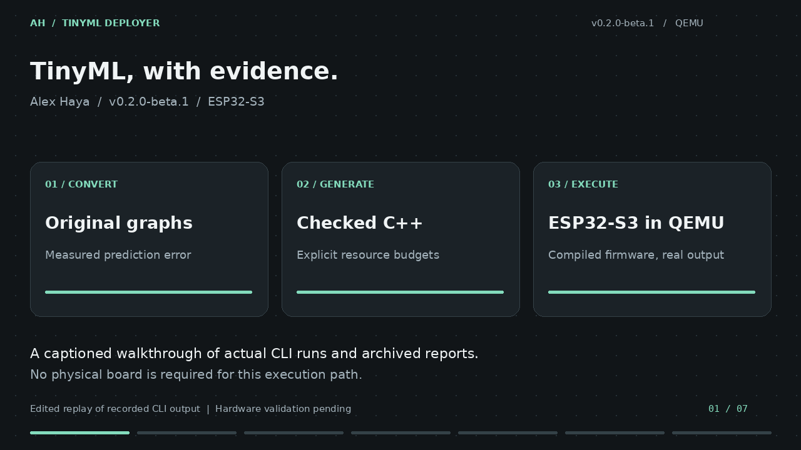
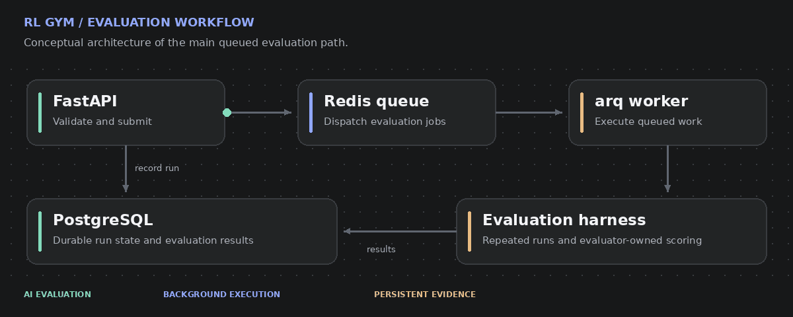
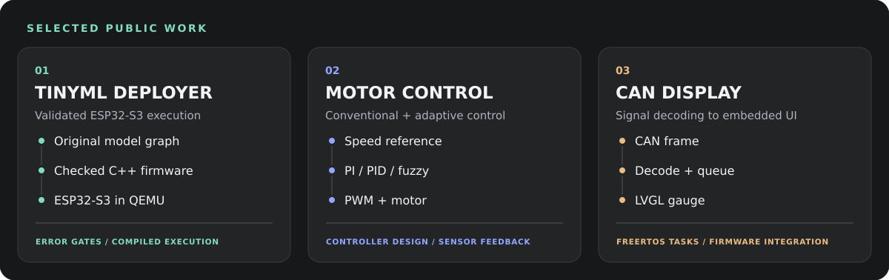

# Alex Haya

**AI Evaluation and Security | Embedded Systems | Applied Machine Learning**

I work across AI evaluation, cybersecurity, and embedded systems, with a background in electrical and electronics engineering. I build tools that connect model behavior, software reliability, and physical systems.

My work spans Python APIs, evaluation infrastructure, microcontroller firmware, and intelligent control. I focus on clear evaluation criteria, failure analysis, and implementations that can be inspected and tested.

[TinyML case study](projects/tinyml-deployer/README.md) · [Public projects](#selected-public-projects) · [Current work](#current-work-rl-gym) · [Technical focus](#technical-focus) · [LinkedIn](https://ke.linkedin.com/in/alex-haya)

## Featured: TinyML Deployer

**Validate ESP32-S3 firmware in QEMU without a physical board.**

Original model graphs, explicit prediction-error gates, generated ESP-IDF C++ and traceable execution reports. Float32 and INT8 integration fixtures each completed 24 QEMU observations within their configured error limits. Physical-board validation remains pending.

**[Read the project case study](projects/tinyml-deployer/README.md)** · [View on GitHub](https://github.com/alexhaya4/tinyml-deployer) · [Release v0.2.0-beta.1](https://github.com/alexhaya4/tinyml-deployer/releases/tag/v0.2.0-beta.1)

## Current work: RL Gym

I am developing **RL Gym**, a Python platform for reinforcement learning, machine learning workflows, and AI agent evaluation.

The platform brings together experiment tracking, dataset management, model evaluation, and background job processing. My current focus includes repeated-run evaluation, evaluator-controlled scoring, adversarial testing, and reliable execution.

**Technologies:** Python, FastAPI, PostgreSQL, Redis, Docker, PyTorch, Gymnasium, and scikit-learn.

*Architecture illustration of the main queued path. Animation shows execution order, not live activity or measured performance. [View the static diagram](assets/rl-gym-workflow.png).*

The source repository is private. The projects below provide public examples of my implementation work.

## Selected public projects

The sketches summarize the implementations linked below.

### TinyML Deployer

**Validated model conversion and ESP32-S3 firmware execution.**

A Python CLI that takes original Keras, SavedModel and ONNX graphs through conversion and quantization, checks prediction error on supplied validation inputs, and generates model-specific ESP-IDF C++ firmware.

- Quantization gates use explicit error limits and supplied calibration data where required.
- Generated C++ registers model operators, checks input/output buffers, and applies explicit arena and flash budgets.
- Pinned Espressif QEMU runs the compiled float32 and INT8 ESP32-S3 fixtures with ESP-NN optimizations enabled.
- JSON and HTML reports preserve model and dataset identities, complete observations, and prediction agreement.

**Current source version:** `0.2.0b1` (beta). Physical-board validation remains pending. STM32 profiles support analysis only.

**[Watch the 54-second walkthrough](https://github.com/alexhaya4/tinyml-deployer/blob/main/docs/walkthrough/v0.2.0-beta.1/walkthrough.mp4)** · [Static poster](https://github.com/alexhaya4/tinyml-deployer/blob/main/docs/walkthrough/v0.2.0-beta.1/poster.png) · [Transcript and reproduction](https://github.com/alexhaya4/tinyml-deployer/tree/main/docs/walkthrough/v0.2.0-beta.1)

*Captioned, silent replay of recorded CLI output. The sine conversion example and the two compiled emulator fixtures are identified separately; presentation timing is edited.*

The archived float32 and INT8 fixtures each completed 24 QEMU inference observations within their configured prediction-error limits. These are different test graphs, each compared with its own desktop model. The results do not establish comparative task accuracy, quantization savings, or physical-board speed.

**Stack:** Python, TensorFlow Lite Micro, C++, ESP-IDF, ESP-NN, Espressif QEMU, Click, pytest.

[Case study](projects/tinyml-deployer/README.md) · [Repository](https://github.com/alexhaya4/tinyml-deployer) · [Release notes](https://github.com/alexhaya4/tinyml-deployer/blob/main/docs/releases/v0.2.0-beta.1.md) · [Archived CI evidence](https://github.com/alexhaya4/tinyml-deployer/tree/main/docs/evidence/qemu-2026-10-13) · [Tests](https://github.com/alexhaya4/tinyml-deployer/tree/main/tests)

### Neuro-Fuzzy DC Motor Control

**Comparing conventional and adaptive control approaches.**

A Raspberry Pi motor-control project with PI, PID, fuzzy logic, and neural-tuned fuzzy controllers. It combines control algorithms with a desktop interface, sensor feedback, plotting, and data export.

- PI/PID implementations with anti-windup and derivative filtering.
- Neural networks used to tune the scaling factors of a Mamdani fuzzy controller.
- Controller comparison through recorded responses and performance metrics.

**Stack:** Python, Raspberry Pi, TensorFlow/Keras, NumPy, GPIO, PWM.

[Repository](https://github.com/alexhaya4/dc-motor-neuro-fuzzy) · [PI/PID implementation](https://github.com/alexhaya4/dc-motor-neuro-fuzzy/blob/main/conventional_controllers.py) · [Neural-tuned controller](https://github.com/alexhaya4/dc-motor-neuro-fuzzy/blob/main/neural_tuned_fuzzy_controller.py)

### ESP32 CAN Display

**Turning CAN bus signals into an embedded gauge interface.**

An ESP-IDF firmware project that receives CAN frames through the TWAI driver, decodes a signal, and updates an LVGL gauge.

- Separate FreeRTOS tasks for CAN reception and display updates.
- Queue-based transfer of decoded values to the interface.
- Signal scaling, range checks, numeric readout, and threshold-based colors.

**Stack:** C, ESP32-S3, ESP-IDF, FreeRTOS, CAN/TWAI, LVGL.

[Repository](https://github.com/alexhaya4/esp32_can_display) · [Firmware](https://github.com/alexhaya4/esp32_can_display/blob/master/main/main.c)

## Technical focus

| Area | Focus |
| --- | --- |
| AI evaluation and security | Agent evaluation, adversarial testing, repeated-run analysis, failure investigation |
| Backend engineering | Python, FastAPI, SQLAlchemy, PostgreSQL, Redis, Docker |
| Embedded systems | C/C++, ESP32, STM32, FreeRTOS, CAN/TWAI, LVGL |
| Applied ML and control | TensorFlow/Keras, PyTorch, scikit-learn, PID, fuzzy logic, model deployment |

## Connect

For engineering collaborations and project discussions, connect with me through [GitHub](https://github.com/alexhaya4) or [LinkedIn](https://ke.linkedin.com/in/alex-haya).

About the visuals

Original SVG illustrations and an animated architecture diagram, with visual inspiration from [Beautiful UI](https://www.beautifului.dev/): charcoal surfaces, rounded cards, compact labels, and a dotted workflow canvas. The project sketches and RL Gym animation are conceptual diagrams. The TinyML preview replays recorded CLI output and links to its transcript and evidence. Portfolio illustrations are stored here; TinyML media is stored in the TinyML Deployer repository.

