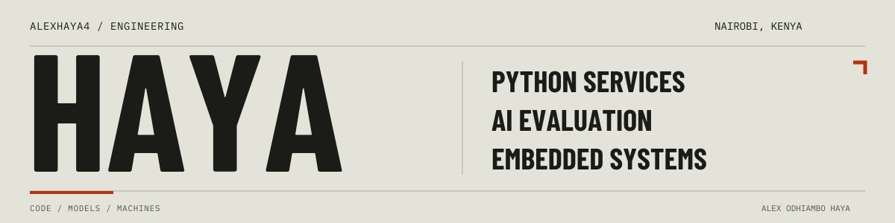
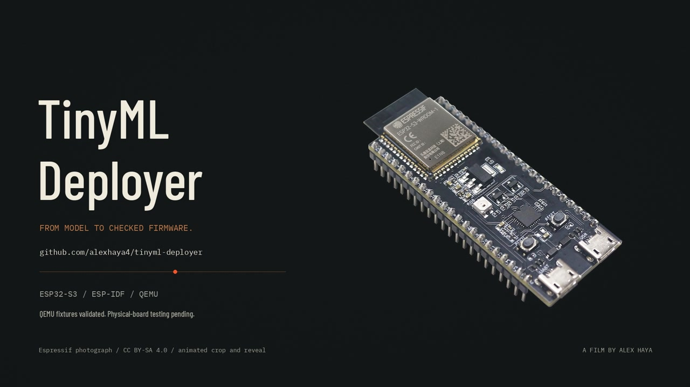

# Alex Odhiambo Haya

**Python Developer | AI Evaluation & Red Teaming**

I build Python backends, AI evaluation tools and model-deployment workflows. My work includes FastAPI services, background workers, PostgreSQL and Redis infrastructure, and embedded ML.

Based in Nairobi, with an electrical and electronics engineering background and professional experience in AI evaluation and agent red teaming at Turing.

**[Open Source Projects](#open-source-projects)** · [Other Public Repositories](#other-public-repositories) · [Portfolio](https://alexhaya4.github.io/alexhaya4/) · [Research](https://alexhaya4.github.io/alexhaya4/papers/)

## Skills

| Area | Skills and implementation work |
| :--- | :--- |
| **Python backend development** | FastAPI, PostgreSQL, Redis, model API integration and background job execution. |
| **Testing and validation** | pytest, prediction-error checks, execution reports and compiled firmware validation in QEMU. |
| **AI evaluation and red teaming** | Adversarial scenarios, agent tool-use evaluation, coding evaluation tasks, rubric-based assessment and reproducible failure cases. |
| **ML and embedded systems** | TensorFlow/Keras, TensorFlow Lite Micro, C/C++, ESP-IDF, FreeRTOS and CAN/TWAI. |

## Open Source Projects

MIT-licensed projects with public source code, documentation and implementation evidence.

### TinyML Deployer

**Open source · [MIT license](https://github.com/alexhaya4/tinyml-deployer/blob/main/LICENSE)**

**Python · TensorFlow Lite Micro · C++ · ESP-IDF · Espressif QEMU**

A Python CLI that converts models, checks prediction error and generates model-specific ESP32-S3 firmware. Float32 and INT8 fixtures run as compiled firmware in QEMU; archived reports preserve model identities, validation inputs and individual predictions. Physical-board validation remains pending.

**[Source](https://github.com/alexhaya4/tinyml-deployer)** · [Case study](https://alexhaya4.github.io/alexhaya4/tinyml/) · [Execution reports](https://github.com/alexhaya4/tinyml-deployer/tree/main/docs/evidence/qemu-2026-10-13) · [Watch Signal to Silicon](https://alexhaya4.github.io/alexhaya4/tinyml/#film)

Film and poster: Alex Haya. Board photograph: <a href="https://github.com/espressif/esp-dev-kits/blob/master/docs/_static/esp32-s3-devkitc-1/esp32-s3-devkitc-1-v1.1-isometric.png">Espressif</a>, cropped and animated. Media: <a href="https://creativecommons.org/licenses/by-sa/4.0/">CC BY-SA 4.0</a>.

### Neuro-Fuzzy Control

**Open source · [MIT license](https://github.com/alexhaya4/dc-motor-neuro-fuzzy/blob/main/LICENSE)**

A Python and Raspberry Pi platform for DC motor-speed control, with PI, PID and neural-tuned fuzzy controllers.

**[Source](https://github.com/alexhaya4/dc-motor-neuro-fuzzy)** · [Research record](https://zenodo.org/records/20124685)

## Other Public Repositories

| Repository | Implementation | License |
| :--- | :--- | :--- |
| [tradingsys](https://github.com/alexhaya4/tradingsys) | Python backend infrastructure, TimescaleDB persistence, a hash-chained audit log and observability. Phase 1 infrastructure; strategies and order placement are not implemented. | [Proprietary](https://github.com/alexhaya4/tradingsys/blob/main/pyproject.toml) |
| [DC Motor Training Station](https://github.com/alexhaya4/dc_motor_training_station) | Python desktop development, manual and ANFIS control, monitoring and session logs. Starts in simulation mode. | Not declared |
| [CAN Display](https://github.com/alexhaya4/esp32_can_display) | C, ESP32-S3, FreeRTOS, CAN/TWAI and LVGL. Signal decoding and queue-based display updates. | Not declared |

## Professional Experience

**Turing · AI Training & Evaluation Specialist · Aug 2025 to Feb 2026**

Agent red teaming, coding evaluation tasks and reproducible failure cases, alongside contributor team leadership. My evaluation work includes instruction following, tool selection, tool arguments, reasoning quality and whether observed results support the final answer.

## Private Work

**Rylgam / RL Gym · Founder & Engineer · Jan 2026 to present**

I am developing an AI agent evaluation platform: Python backend, model API clients and background workers, with isolated agent execution, tenant access controls and usage tracking. Built with FastAPI, PostgreSQL and Redis, with a React/TypeScript interface. Private source, in development.

[Project notes](https://alexhaya4.github.io/alexhaya4/#rl-gym)

## AI Safety Research

[Hallucination Detection and Vulnerability Discovery in Large Language Models](https://alexhaya4.github.io/alexhaya4/papers/#ai-safety): a manuscript on adversarial evaluation, hallucination types and grounding verification.

[What Resists Relocation](https://alexhaya4.github.io/alexhaya4/papers/#reward-hacking): an unpublished study of deployment-framed reward-hacking tasks and measurement limits. The downstream experiment on evaluation framing has not been run.
